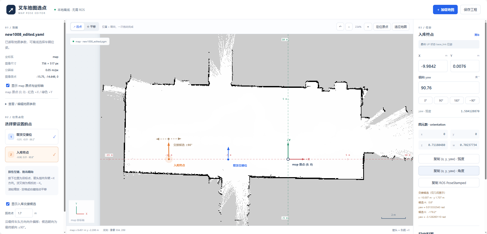

# MapPoseEditor

## 在线使用

**直接打开：[https://knighthood2001.github.io/MapPoseEditor/](https://knighthood2001.github.io/MapPoseEditor/)**

无需安装软件或启动 ROS / Nav2。打开网页后，同时选择地图 YAML 与对应 PGM / PNG 图片，即可选点、设置朝向、复制位姿及导出配置。
地图文件只在访问者自己的浏览器中处理，不会上传至服务器。在线版首次打开需要网络；下载完整仓库后仍可离线使用。

## 离线使用

直接双击本目录的 `index.html`。不需要安装软件、不需要启动网页服务器、ROS 或 Nav2，也不需要联网。

## 网页发布

本仓库使用 GitHub Pages，从 `main` 分支根目录发布。推送到 `main` 后，GitHub 会自动更新在线版本。
`.nojekyll` 用于直接发布 HTML、JavaScript 和 CSS，无需安装依赖或执行构建。

## 加载地图

点击“加载地图”，同时选中 Nav2 的地图 YAML 和它对应的图片；也可以把这两个文件一起拖进网页。
支持 `.pgm`（P2/P5，含16位灰度）、PNG、JPG、BMP、WebP。
YAML 支持 Nav2 常见的 origin 行内列表与多行列表格式。

本目录 `示例地图` 中附带远程工作区当前的 `new1008_edited.yaml` 与 `new1008_edited.pgm` 副本。


由于浏览器限制，读取 YAML 不会自动获得其 image 路径的文件权限。因此需要同时选择对应图片，或者先后分别加载。
若只加载图片，必须在左侧手动填写正确的 resolution 和 origin，不能假定默认值就是实际地图参数。


## 选择位置与朝向

1. 左侧选择“取货交接位”或“入库终点”。
2. 在地图上按下鼠标左键：这里就是目标位置。
3. 按住并拖动：箭头方向就是车辆 +X 朝向；松开后完成设置。只点击时保留原朝向，首次默认为 map 的0度。
4. 右侧显示 map 下的 X、Y、yaw（度和弧度）、orientation 四元数。可以直接修改数值。
5. 可用0°、90°、180°、−90°按钮快速设置角度。

地图上显示真正的 **map 原点 (0,0)**，以及红色 +X、绿色 +Y 坐标轴和米制刻度；坐标轴随地图的 origin yaw 正确换算。
这与 YAML 的 origin 不同：YAML origin 是图像左下边界在 map 下的位姿，另用灰色菱形标注“图像原点”。
左侧可开关坐标轴；若原点在当前视图外，可点击画布上方“定位原点”，只改变视图、不改变选点。
若 map 原点本身在图像范围外，会明确提示，不会把图像边角当成 (0,0)。

滚轮缩放；空格+左键、鼠标右键、中键或“平移”工具拖动画布。“适应地图”恢复完整视图。
“↶”或 Ctrl+Z 撤销最近一次选点/参数编辑中的点位操作。
修改地图 resolution/origin 会保持点在图片上的位置，并重新计算其 map 坐标和朝向，清除原点位撤销历史。

## 点位的业务含义

- **取货交接位**：车辆到达托盘前方、准备识别对叉的停车位姿。
- **入库终点**：入库结束时，UP 状态下车辆 base_link 的目标位姿。
- 两者都是车辆位姿，**不是托盘中心**；与当前任务链的 vehicle 参考模式匹配。
- 箭头朝车辆 +X 方向；本项目货叉方向为 −X，不能把箭头当成叉尖方向。

可显示入库交接候选：从最终入库点沿最终车头方向前移1.7米，两个候选朝向为最终朝向±90°。
这些只是几何候选；实际入库算法仍需检查可行性后选择。

## 导出并用于任务链

设置两个点后点击“完整任务 task.yaml”，得到：

```yaml
frame: map
pickup: {x: ..., y: ..., yaw: ...}
dropoff: {x: ..., y: ..., yaw: ...}
timeout: 1800.0
```

导出的 yaw 已经转换为弧度。

“复制 ROS PoseStamped”可复制 map 下的位置和四元数。
右侧还提供“复制 (x,y,yaw) · 弧度”和“复制 (x,y,yaw) · 角度”。默认任务配置使用弧度；两种复制结果的单位由按钮名称明确区分。
例如弧度版为 `(-10.183000, 1.940000, 1.570796327)`，角度版为 `(-10.183000, 1.940000, 90.000000)`。
交接候选分别显示 A、B 的角度和对应 yaw 弧度，例如 0°对应0 rad，180°对应3.141592654 rad。

## 保存工程

点击“保存工程”导出 `map_points.json`。其中包含地图图片、地图参数、两组点位及交接距离。
以后直接加载该 JSON，即可恢复，不需要再选择原始地图文件。
修改地图或加载另一张地图时会清空旧选点，建议先保存工程。
输入框编辑地图原点、或者给已加载图片补读同名 YAML 时，会保留图片位置并重新换算选点。

## 坐标换算

图片连续坐标 (u, v) 从左上角计算；图片高度为 H，分辨率 r，origin=[ox,oy,φ]：

```text
local_x = u × r
local_y = (H − v) × r
map_x = ox + cos(φ) × local_x − sin(φ) × local_y
map_y = oy + sin(φ) × local_x + cos(φ) × local_y
```

像素中心使用 u=列号+0.5、v=行号+0.5。图像的左下边界对应地图原点，不是左上角。
朝向为 map +X 方向逆时针旋转的角度，四元数 z=sin(yaw/2)、w=cos(yaw/2)。

本工具显示保存的静态地图，不显示实时雷达、定位、膨胀层或现场新增障碍物。
它用于确定地图位姿，不能代替实际导航/入库的可达性与碰撞检查。


